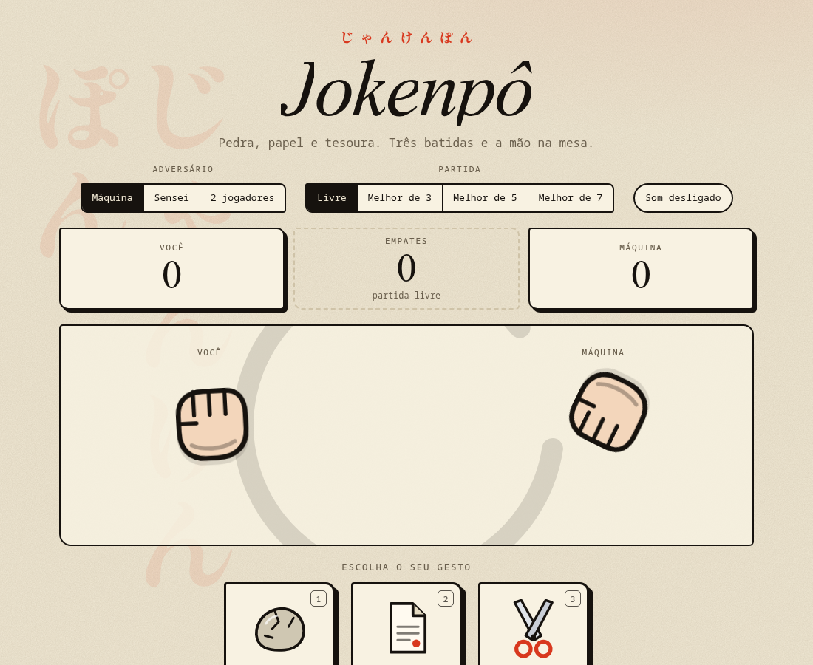
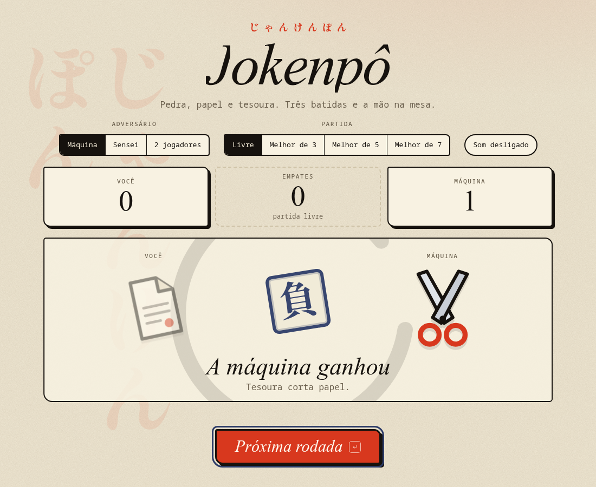
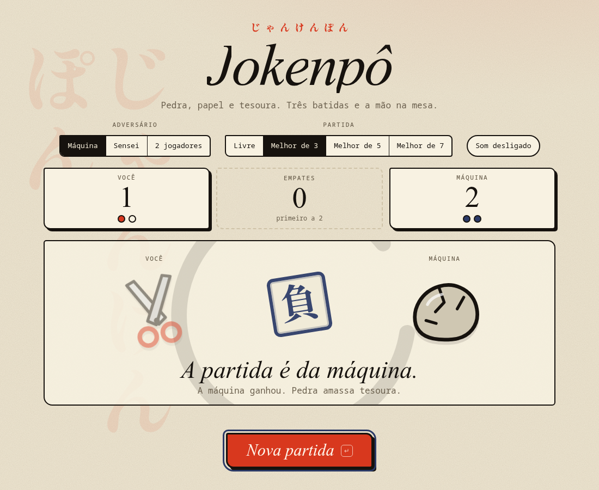
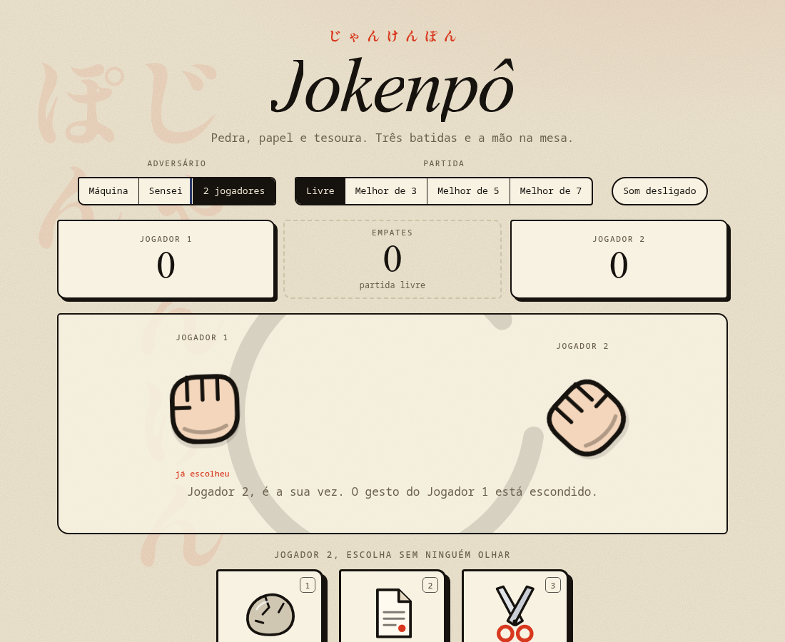
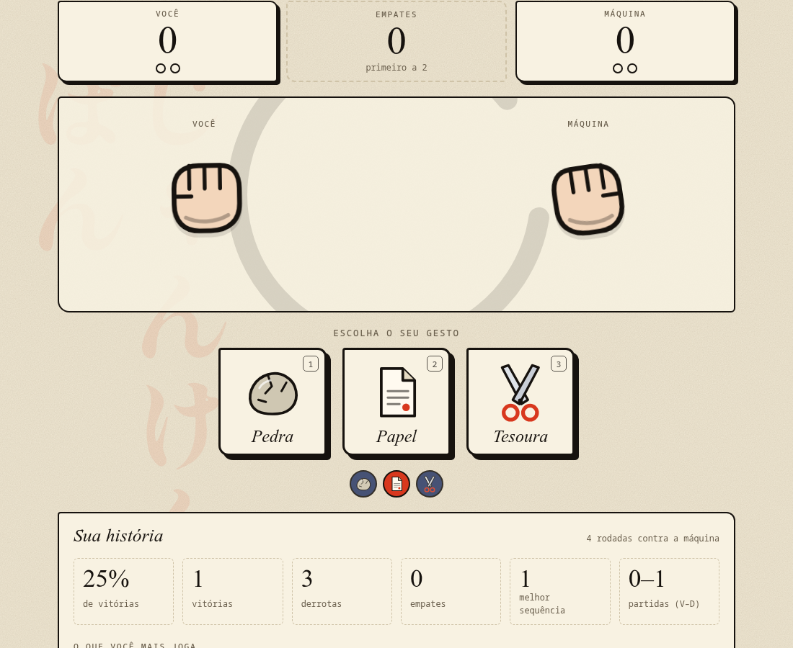
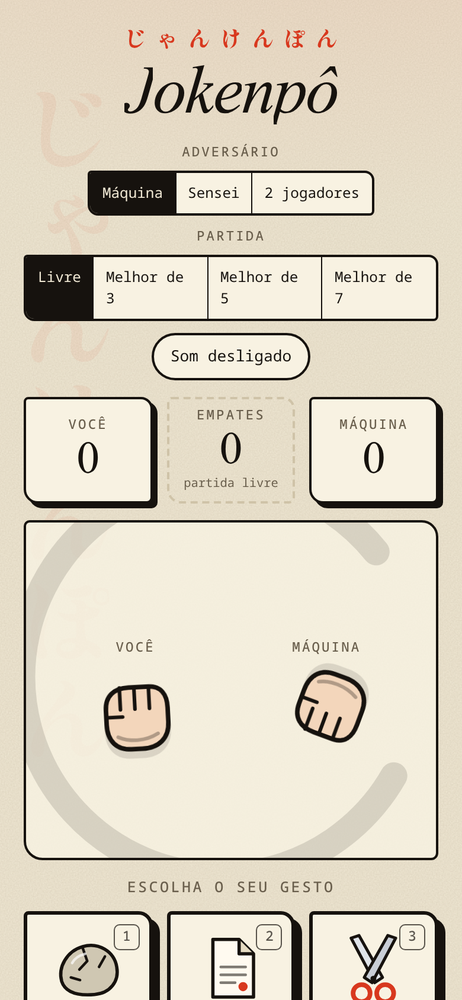

# Jokenpô

Pedra, papel e tesoura com ritual de **jan-ken-pon**: três batidas, punhos tremendo e um carimbo vermelho no papel dando o veredito. Visual de papel washi e tinta sumi, com ícones desenhados à mão em SVG.

| Jogo | Resultado | Fim de partida |
|---|---|---|
|  |  |  |

| 2 jogadores | Estatísticas | Celular |
|---|---|---|
|  |  |  |

## O que tem

- **Três adversários**: a **Máquina** joga ao acaso; o **Sensei** aprende o seu jeito de jogar; o modo **2 jogadores** funciona no mesmo aparelho, e o gesto do jogador 1 fica escondido até o jogador 2 escolher.
- **Formato**: partida livre ou melhor de 3, 5 e 7, com pontos marcados no placar.
- **Contagem animada**: JAN, KEN e PON em GSAP, com os punhos batendo. No PON as mãos se revelam, o carimbo (勝 vitória, 負 derrota, 分 empate) bate no papel e a frase conta a história da jogada ("Papel embrulha pedra.").
- **Estatísticas que ficam** (localStorage): aproveitamento, melhor sequência, partidas ganhas e o que você mais joga.
- **Teclado**: `1` pedra, `2` papel, `3` tesoura, `Enter` segue, `R` recomeça. Funciona com toque no celular.
- **Sons** sintetizados na hora (WebAudio, sem arquivos), desligados por padrão.
- **Acessível**: resultado anunciado por leitor de tela, foco gerenciado e respeito a `prefers-reduced-motion` (a revelação vira instantânea).

## Como o Sensei joga

Ele olha o histórico da pessoa e aposta no próximo gesto: primeiro, o que ela costuma jogar depois do último gesto (uma cadeia de Markov de ordem 1); sem dados, o gesto que ela mais joga. Então joga o que vence a aposta. Em 15% das vezes sorteia, para não ficar previsível.

Contra quem repete um gesto ou segue uma sequência, ele vence quase sempre. Contra quem joga ao acaso, **ninguém ganha na média**: os testes garantem que ele não passa de 40% de vitórias nesse caso.

## Rodando

```bash
npm install
npm run dev      # http://localhost:5175
npm test         # 26 testes das regras, da IA, da partida e do armazenamento
npm run lint
npm run build
```

O jogo é um site estático (`base` relativa no Vite), então roda em qualquer hospedagem. O workflow `pages.yml` publica no GitHub Pages a cada push na `main`: ative em *Settings → Pages → Source: GitHub Actions*.

## Estrutura

```
src/jogo.js          regras, frases, Sensei, placar e estatísticas (sem nada de tela)
src/partida.js       estado da partida como máquina de fases (reducer puro)
src/armazenamento.js localStorage que aguenta dado corrompido
src/animacao.js      GSAP: plugins, tremor de derrota, confete com física
src/componentes/     Arena, Controles, Placar, Histórico, Estatísticas, Opções, ícones SVG
```

GSAP usado: `useGSAP` com `matchMedia`, SplitText (título), DrawSVG (círculo ensō), CustomWiggle (tremor ao perder) e Physics2D (confete ao vencer a partida).

## O que mudou nesta versão

A primeira versão (2022) era uma página com três botões que manipulava o DOM com `getElementById` dentro do React, sem placar, sem histórico e com a escolha do computador atrasada num `setTimeout`. Foi reescrita com a lógica separada da tela, testes, novos modos e visual próprio.
